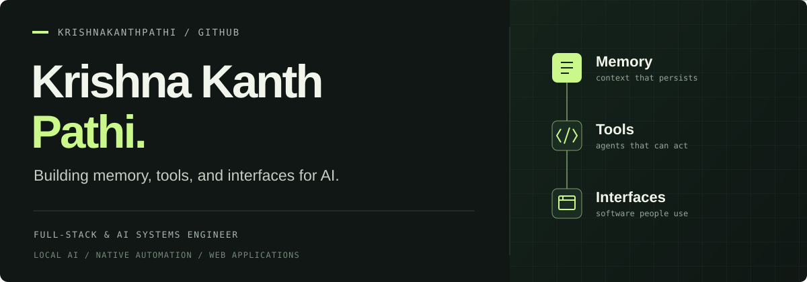

  

  <a href="#selected-builds">Selected builds</a> &nbsp; / &nbsp;
  <a href="#engineering-stack">Engineering stack</a> &nbsp; / &nbsp;
  <a href="#outside-the-editor">Outside the editor</a> &nbsp; / &nbsp;
  <a href="mailto:krishnakanthpathi@gmail.com">Get in touch ↗</a>

 

I’m **Krishna**, a full-stack and AI systems engineer. I build software across the layers: local memory engines in Rust, tools that connect agents to the desktop, and the web and native interfaces around them.

My focus is practical: **help agents remember context, take useful actions, and fit into everyday workflows.**

 

01 / PROJECT INDEX

## Selected builds

### ❖ LightMem

**Persistent memory, built to run locally.**

A Rust memory engine that gives AI agents context across sessions. Combines SQLite FTS5 and vector search with local extractive question answering, linked memories, and multimodal attachments. Available through a CLI, Python SDK, and native MCP server.

`Rust` `SQLite` `ONNX Runtime` `MCP`

[Explore the source ↗](https://github.com/krishnakanthpathi/lightmem) &nbsp;·&nbsp; [Get it on PyPI ↗](https://pypi.org/project/lmem/)

---

### ∑ Maxi

**A little less clicking.**

A voice-controlled desktop assistant with a native macOS floating HUD. Connect an OpenAI-compatible model backend and your MCP servers to bring voice input, dictation, and desktop tools into one workflow. Supports optional LightMem integration; available as a macOS beta.

`Python` `SwiftUI` `MCP`

[Explore the source ↗](https://github.com/krishnakanthpathi/maxi) &nbsp;·&nbsp; [Download a release ↗](https://github.com/krishnakanthpathi/maxi/releases)

---

### Tools, networks & web platforms

| Project | What it does | Built with |
| :--- | :--- | :--- |
| **[Native Assistant MCP ↗](https://github.com/krishnakanthpathi/native-assistant-mcp)** | Exposes native macOS and Windows capabilities to agents: windows, processes, clipboard, files, and system automation. | Python · FastMCP · Native APIs |
| **[LocalShare ↗](https://github.com/krishnakanthpathi/localshare)** | Shares files and folders across a local network with UDP discovery, direct TCP transfers, and live progress. | Node.js · React · WebSockets |
| **[QueryPort ↗](https://github.com/krishnakanthpathi/QueryPort)** | A headless portfolio platform with APIs for projects, skills, achievements, and public profiles. | TypeScript · React · Express · MongoDB |
| **[Discord Bot MCP ↗](https://github.com/krishnakanthpathi/discord-bot-mcp)** | Connects agents to Discord messaging, channel management, file attachments, and voice playback. | Python · FastMCP · discord.py |

 

02 / TOOLKIT

## Engineering stack

**Languages** 
`Rust` `Python` `TypeScript` `JavaScript` `Java` `C++`

**Interfaces & APIs** 
`React` `Next.js` `Node.js` `Express` `Tailwind CSS` `SwiftUI`

**Storage & retrieval** 
`SQLite` `FTS5 / BM25` `PostgreSQL` `MongoDB` `Vector search`

**AI & systems** 
`ONNX Runtime` `Ollama` `MCP` `Docker` `Linux` `macOS`

 

03 / CURIOSITY

## Outside the editor

I like understanding what happens below the application layer: **process scheduling, memory layout, concurrency, and socket I/O**. I’m also exploring local AI runtimes and how to retrieve the right context for an agent.

Algorithms are part of that practice. Find me on [LeetCode ↗](https://leetcode.com/krishnakanthpathi/) and [Codeforces ↗](https://codeforces.com/profile/krishnakanthpathi), or browse my [competitive programming solutions ↗](https://github.com/krishnakanthpathi/cp-programs).

 

---

  HAVE SOMETHING IN MIND?  
  <b>Let’s build something useful.</b>  
  <a href="mailto:krishnakanthpathi@gmail.com">krishnakanthpathi@gmail.com ↗</a>

